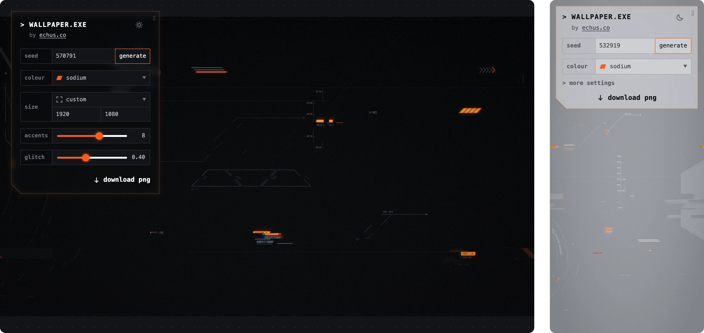

# cyberpunk-wallpaper-generator

Generate minimal, glitchy cyberpunk wallpapers.



## Run locally

The site is static files in `public/`.

```bash
npx wrangler dev
```

Any static file server also works, e.g. `python3 -m http.server -d public`.

## Deploy

Deploy via Cloudflare with:

```bash
npx wrangler deploy
```

## README image

After a change to the interface, remake `examples/preview.webp` with:

```bash
npm install
npm run readme-image
```

The script uses the installed Chrome. Set `CHROME` to a browser's path to use another one.

## Files

- `public/wallpaper.js`: makes the shapes and the layout.
- `public/effects.js`: glitches, vignette and grain.
- `public/random.js`: seeded random numbers.
- `public/app.js`: connects the page controls to the generator.
- `scripts/readme-image.js`: makes the README image. The seeds and settings in the image are at its top.

The mode icons are based on [Pixelarticons](https://github.com/halfmage/pixelarticons) by Gerrit Halfmann, under the MIT license.

This generator was previously a Python script available at the [v1-python](https://github.com/echus/cyberpunk-wallpaper-generator/tree/v1-python) tag.
