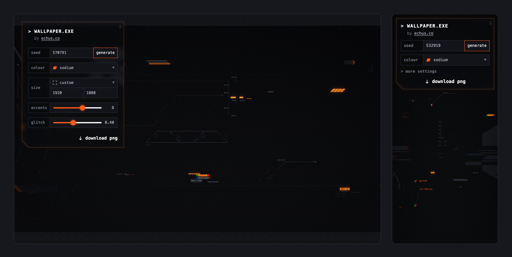

# cyberpunk-wallpaper-generator

Generate minimal, glitchy cyberpunk wallpapers.



## Run locally

The site is static files in `public/`. It has no build step and no dependencies.

```bash
npx wrangler dev
```

Any static file server also works, for example `python3 -m http.server -d public`.

## Deploy

The site runs as a Cloudflare Worker with static assets (see `wrangler.jsonc`).

```bash
npx wrangler deploy
```

## Files

- `public/wallpaper.js`: makes the shapes and the layout.
- `public/effects.js`: glitches, vignette and grain.
- `public/random.js`: seeded random numbers.
- `public/app.js`: connects the page controls to the generator.

The first version was a Python script. It is at the [`v1-python`](https://github.com/echus/cyberpunk-wallpaper-generator/tree/v1-python) tag.
